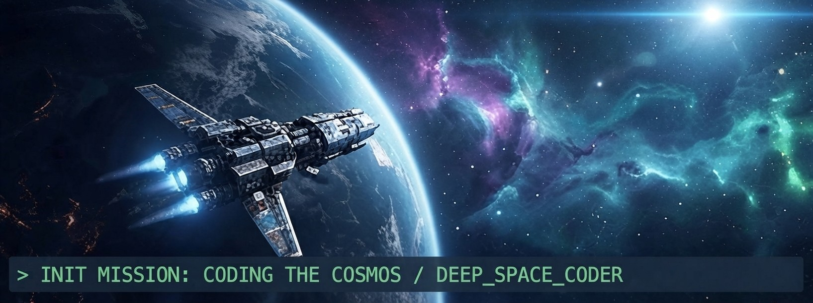

  

<h1 align="center">👨‍💻 About Me</h1>

🔭 I’m currently working on Full-Stack Web Applications

💻 Full-Stack Web Developer | Crafting scalable & modern web applications.

🛠️ Skills: JavaScript, Git/GitHub & CLI Automation

🌱 Learning: React.js, Next.js, Node.js & Express.js

💬 Ask me about Web Development & JavaScript

😄 Pronouns: He/Him

⚡ Fun fact: Love building automated tools & solving complex dev challenges!

<!-- 
📫 How to reach me: md.samiulislam.swe@gmail.com
 -->

<h1 align="center">🛠️ Tech Stack & Skills</h1>

  <b>💻 Programming Languages</b>  
  

  <b>🚀 Frameworks & Libraries</b>  
  

  <b>⚙️ Backend Technologies</b>  
  

  <b>🗄️ Databases & Cloud</b>  
  

  <b>🛠️ Tools & Technologies</b>  
  

<h1 align="center">☕ Find Me Online</h1>

  
  
  
  
  
  
  
  
  

<!-- ## 🏆 GitHub Trophies
<h1 align="center">🏆 GitHub Trophies</h1>

  

 -->

<!--  -->

<h1 align="center">🔥 GitHub Streak</h1>

  

  

  

<!-- 

  

 -->

  

  
  
  

  

<h1 align="center">🐍 My GitHub Contributions as Snake Game</h1>

  

<h1 align="center">✍️ Random Dev Quote</h1>

<!--  -->

<!-- Created with GPRM ( https://gprm.itsvg.in ) -->
